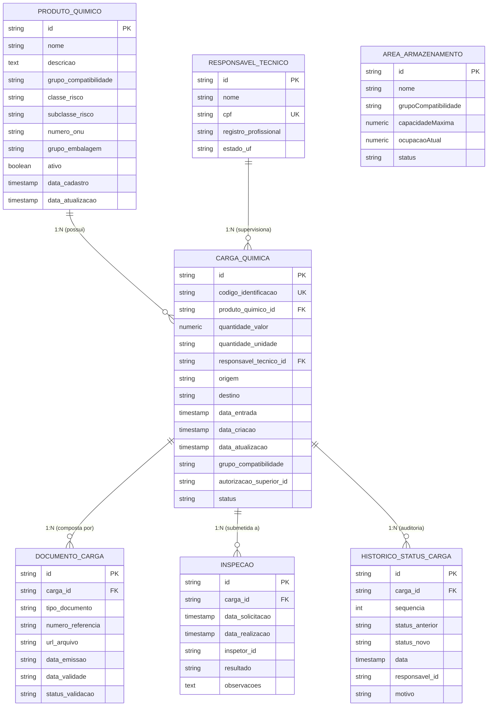
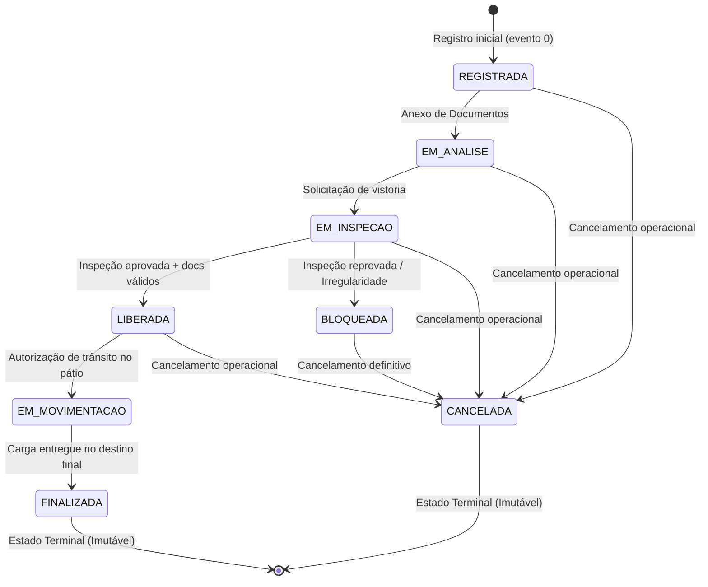

# Modelagem de Dados e Máquina de Estados da Carga Química

> **QuimiPort — Gestão de Cargas Químicas Portuárias**  
> Documento técnico de especificação do modelo de dados relacional, integridade referencial e máquina de estados da carga (Fase 2).

---

## 1. Justificativa da Escolha do Banco de Dados: PostgreSQL 16

Para o backend do QuimiPort, a escolha do **PostgreSQL 16** como banco de dados relacional oficial baseou-se nos seguintes pilares arquiteturais:

1. **Garantias ACID e Consistência Rígida:**
   A movimentação de produtos químicos perigosos em ambiente portuário exige que transições de status, anexos de documentos e registros de inspeção sejam atômicos e consistentes. O PostgreSQL assegura que nenhuma carga fique em estado inconsistente caso ocorra falha no processo.
2. **Integridade Referencial Forte com Chaves Estrangeiras (`FOREIGN KEY`):**
   Regras como `onDelete: 'RESTRICT'` impedem a exclusão acidental de produtos químicos ou responsáveis técnicos que possuam cargas ativas associadas.
3. **Tipos de Dados Especializados e Enumerações Nativas:**
   Suporte nativo a enumerações fortemente tipadas (`StatusCarga`), precisão monetária/quantitativa (`NUMERIC(10,2)`) e auditoria temporal com precisão de microssegundos (`TIMESTAMP WITH TIME ZONE`).
4. **Evolução e Escalabilidade:**
   Excelente suporte para expansão do esquema relacional, mantendo integridade e desempenho à medida que a aplicação avança para as próximas fases do curso.

---

## 2. Diagrama Entidade-Relacionamento (DER)

Abaixo está o diagrama do modelo relacional implementado via **TypeORM**, com todas as tabelas, chaves primárias (PK), chaves estrangeiras (FK) e cardinalidades:

---

## 3. Dicionário de Dados Detalhado

### 3.1. Tabela `produto_quimico`
Armazena o catálogo de substâncias químicas perigosas homologadas para trânsito no terminal portuário.

| Coluna | Tipo PostgreSQL | Nulo? | Chave | Descrição / Regra |
| :--- | :--- | :---: | :---: | :--- |
| `id` | `VARCHAR(36)` | Não | **PK** | Identificador único com prefixo de domínio (ex: `PRQ-...`). |
| `nome` | `VARCHAR(255)` | Não | — | Nome comercial ou técnico do produto químico. |
| `descricao` | `TEXT` | Não | — | Descrição detalhada do composto e aplicações. |
| `grupo_compatibilidade`| `VARCHAR(100)` | Não | — | Grupo de segregação química (ex: "Ácido forte mineral"). |
| `classe_risco` | `VARCHAR(10)` | Não | — | Classe de risco ONU/IMDG (1 a 9). |
| `subclasse_risco` | `VARCHAR(10)` | Sim | — | Subclasse de risco subsidiário (ex: "8.1"). |
| `numero_onu` | `VARCHAR(4)` | Não | — | Código ONU de 4 dígitos numéricos (ex: "1830"). |
| `grupo_embalagem` | `VARCHAR(10)` | Sim | — | Grau de perigo da embalagem (I, II ou III). |
| `ativo` | `BOOLEAN` | Não | — | `DEFAULT true`. Inativação lógica; produtos inativos não entram em novas cargas. |
| `data_cadastro` | `TIMESTAMP` | Não | — | Data/hora do registro inicial no sistema. |
| `data_atualizacao` | `TIMESTAMP` | Não | — | Data/hora da última alteração cadastral. |

*Índice Único:* `IDX_produto_nome_classe` em `(nome, classe_risco)` impedindo cadastro duplicado do mesmo produto na mesma classe de perigo.

---

### 3.2. Tabela `carga_quimica`
Tabela central da operação. Representa o lote físico de produto químico em trânsito no terminal.

| Coluna | Tipo PostgreSQL | Nulo? | Chave | Descrição / Regra |
| :--- | :--- | :---: | :---: | :--- |
| `id` | `VARCHAR(36)` | Não | **PK** | Identificador único (ex: `CRQ-...`). |
| `codigo_identificacao` | `VARCHAR(50)` | Não | **UK** | Código alfanumérico da carga visível nos contêineres/manifestos. |
| `produto_quimico_id` | `VARCHAR(36)` | Não | **FK** | Referencia `produto_quimico(id)` com `ON DELETE RESTRICT`. |
| `quantidade_valor` | `NUMERIC(10,2)` | Não | — | Quantidade informada da carga (obrigatoriamente $> 0$). |
| `quantidade_unidade` | `VARCHAR(20)` | Não | — | Unidade de medida (`TONELADAS`, `QUILOGRAMAS`, `LITROS`, `METROS_CUBICOS`). |
| `responsavel_tecnico_id`| `VARCHAR(36)` | Não | **FK** | Referencia `responsavel_tecnico(id)` com `ON DELETE RESTRICT`. |
| `origem` | `VARCHAR(100)` | Não | — | Local de procedência ou porto de embarque. |
| `destino` | `VARCHAR(100)` | Não | — | Destino final ou área portuária prevista. |
| `data_entrada` | `TIMESTAMP` | Não | — | Data/hora do recebimento físico no porto. |
| `data_criacao` | `TIMESTAMP` | Não | — | `DEFAULT CURRENT_TIMESTAMP`. Registro da carga no sistema. |
| `data_atualizacao` | `TIMESTAMP` | Não | — | `DEFAULT CURRENT_TIMESTAMP`. Atualizado a cada mudança de estado. |
| `grupo_compatibilidade`| `VARCHAR(100)` | Não | — | Grupo de compatibilidade validado na entrada. |
| `autorizacao_superior_id`| `VARCHAR(36)` | Sim | — | ID do gestor que aprovou registro retroativo (quando aplicável). |
| `status` | `VARCHAR(30)` | Não | — | Estado atual na máquina de estados (ex: `REGISTRADA`, `LIBERADA`...). |

---

### 3.3. Tabela `responsavel_tecnico`
Cadastro de profissionais químicos ou engenheiros habilitados pelo conselho de classe (CRQ/CREA).

| Coluna | Tipo PostgreSQL | Nulo? | Chave | Descrição / Regra |
| :--- | :--- | :---: | :---: | :--- |
| `id` | `VARCHAR(36)` | Não | **PK** | Identificador único (`RT-...`). |
| `nome` | `VARCHAR(150)` | Não | — | Nome completo do responsável. |
| `cpf` | `VARCHAR(14)` | Não | **UK** | CPF formatado (`000.000.000-00`) com validação algorítmica. |
| `registro_profissional` | `VARCHAR(50)` | Não | — | Número de registro no órgão de classe (ex: "CRQ 12345"). |
| `estado_uf` | `VARCHAR(2)` | Não | — | Unidade federativa de emissão do conselho (ex: "SP"). |

---

### 3.4. Tabela `documento_carga`
Documentos obrigatórios de conformidade regulatória (FISPQ, Ficha de Emergência, Manifesto de Carga).

| Coluna | Tipo PostgreSQL | Nulo? | Chave | Descrição / Regra |
| :--- | :--- | :---: | :---: | :--- |
| `id` | `VARCHAR(36)` | Não | **PK** | Identificador do documento (`DOC-...`). |
| `carga_id` | `VARCHAR(36)` | Não | **FK** | Referencia `carga_quimica(id)` com `ON DELETE CASCADE`. |
| `tipo_documento` | `VARCHAR(50)` | Não | — | Ex: `FISPQ`, `FICHA_EMERGENCIA`, `DECLARACAO_IMO`. |
| `numero_referencia` | `VARCHAR(100)` | Não | — | Número de série/protocolo do documento emitido. |
| `url_arquivo` | `VARCHAR(255)` | Não | — | Caminho ou link seguro para o arquivo digital. |
| `data_emissao` | `VARCHAR(10)` | Não | — | Data no formato ISO (`YYYY-MM-DD`). |
| `data_validade` | `VARCHAR(10)` | Não | — | Data de vencimento. Documento vencido bloqueia liberação da carga. |
| `status_validacao` | `VARCHAR(20)` | Não | — | `PENDENTE`, `APROVADO` ou `REJEITADO`. |

---

### 3.5. Tabela `inspecao`
Vistorias físicas realizadas por inspetores portuários no pátio ou armazém.

| Coluna | Tipo PostgreSQL | Nulo? | Chave | Descrição / Regra |
| :--- | :--- | :---: | :---: | :--- |
| `id` | `VARCHAR(36)` | Não | **PK** | Identificador da inspeção (`INSP-...`). |
| `carga_id` | `VARCHAR(36)` | Não | **FK** | Referencia `carga_quimica(id)` com `ON DELETE CASCADE`. |
| `data_solicitacao` | `TIMESTAMP` | Não | — | Momento em que a vistoria foi requerida. |
| `data_realizacao` | `TIMESTAMP` | Não | — | Momento da realização em campo. |
| `inspetor_id` | `VARCHAR(36)` | Não | — | Identificador do inspetor credenciado. |
| `resultado` | `VARCHAR(20)` | Não | — | `PENDENTE`, `APROVADO` ou `REPROVADO`. |
| `observacoes` | `TEXT` | Sim | — | Justificativa técnica (obrigatória em caso de reprovação). |

---

### 3.6. Tabela `historico_status_carga`
Trilha de auditoria imutável (*Event Sourcing* simplificado) que registra cada transição de status sofrida pela carga.

| Coluna | Tipo PostgreSQL | Nulo? | Chave | Descrição / Regra |
| :--- | :--- | :---: | :---: | :--- |
| `id` | `VARCHAR(60)` | Não | **PK** | Identificador sequencial (`cargaId-status-sequencia`). |
| `carga_id` | `VARCHAR(36)` | Não | **FK** | Referencia `carga_quimica(id)` com `ON DELETE CASCADE`. |
| `sequencia` | `INTEGER` | Não | — | Índice sequencial da transição (0 = criação, 1, 2...). |
| `status_anterior` | `VARCHAR(30)` | Sim | — | Status anterior (`NULL` apenas no evento 0 de criação). |
| `status_novo` | `VARCHAR(30)` | Não | — | Status assumido pela carga. |
| `data` | `TIMESTAMP` | Não | — | Data e hora exata do evento de transição. |
| `responsavel_id` | `VARCHAR(36)` | Não | — | Operador ou responsável que disparou a alteração. |
| `motivo` | `TEXT` | Não | — | Justificativa operacional obrigatória para auditoria. |

---

## 4. Máquina de Estados da Carga Química

A governança do ciclo de vida da carga química é modelada no agregado `CargaQuimicaAggregate` como uma **Máquina de Estados Finita (FSM)** rígida. Mudanças inválidas são rejeitadas com erro de domínio (`TransicaoStatusInvalidaError` $\rightarrow$ HTTP 422).

### 4.1. Diagrama de Transições de Status

---

### 4.2. Matriz de Transições Permitidas

| Status Atual | Próximos Status Permitidos | Condição / Regra de Negócio Exigida |
| :--- | :--- | :--- |
| `REGISTRADA` | `EM_ANALISE`, `CANCELADA` | Inicia automaticamente quando a documentação obrigatória é anexada. |
| `EM_ANALISE` | `EM_INSPECAO`, `CANCELADA` | Disparado pelo agendamento da vistoria técnica em campo. |
| `EM_INSPECAO` | `LIBERADA`, `BLOQUEADA`, `CANCELADA` | **Para LIBERADA:** exige 100% dos documentos aprovados e dentro da validade + vistoria física com parecer `APROVADO`. **Para BLOQUEADA:** disparado caso a inspeção seja reprovada. |
| `LIBERADA` | `EM_MOVIMENTACAO`, `CANCELADA` | Permite início do transporte interno para embarque ou berço de armazenagem. |
| `BLOQUEADA` | `CANCELADA` | Cargas bloqueadas não podem ser movimentadas nem liberadas diretamente. |
| `EM_MOVIMENTACAO`| `FINALIZADA` | Conclusão bem-sucedida do transporte até a entrega. |
| `FINALIZADA` | *Nenhum (Terminal)* | Operação concluída. Carga imutável. |
| `CANCELADA` | *Nenhum (Terminal)* | Operação cancelada. Carga imutável. |

---

### 4.3. Exemplos de Transições Proibidas e Justificativa Operacional

| Tentativa Proibida | Justificativa de Segurança Operacional |
| :--- | :--- |
| `CANCELADA` $\rightarrow$ `LIBERADA` | **Gravíssimo:** Uma carga cancelada administrativamente não pode voltar a circular sem novo processo do zero. |
| `BLOQUEADA` $\rightarrow$ `EM_MOVIMENTACAO` | **Bloqueio Crítico:** Impede risco de vazamento, explosão ou incompatibilidade química no pátio portuário. |
| `FINALIZADA` $\rightarrow$ `EM_MOVIMENTACAO` | Carga já entregue não pode ser reaberta (violação de integridade física). |
| `REGISTRADA` $\rightarrow$ `FINALIZADA` | Proíbe pular etapas obrigatórias de análise documental e vistoria de campo. |
| `EM_INSPECAO` $\rightarrow$ `FINALIZADA` | Nenhuma carga atinge o destino final sem antes obter a `LIBERADA`. |
| `LIBERADA` $\rightarrow$ `REGISTRADA` | O fluxo operacional é unidirecional; não existe retrocesso de status. |

---

## 5. Plano de Evolução dos Dados nas Próximas Fases

O modelo relacional do PostgreSQL foi desenhado para evoluir de forma consistente acompanhando o cronograma do curso:

1. **Fase 3 — Frontend Web:**
   - Adição de suporte a paginação e filtros compostos (por período, status e produto) para alimentar os dashboards e painéis visuais do operador portuário.
2. **Fase 4 — Desenvolvimento Mobile:**
   - Otimização de consultas rápidas e enxutas para consumo pelos aplicativos de campo utilizados por inspetores e operadores no pátio.
3. **Fase 5 — Microsserviços, DevOps e Cloud:**
   - O modelo já isola o histórico de status e auditoria, facilitando a transição para serviços desacoplados e banco de dados gerenciado em nuvem (ex: AWS RDS ou GCP Cloud SQL).
